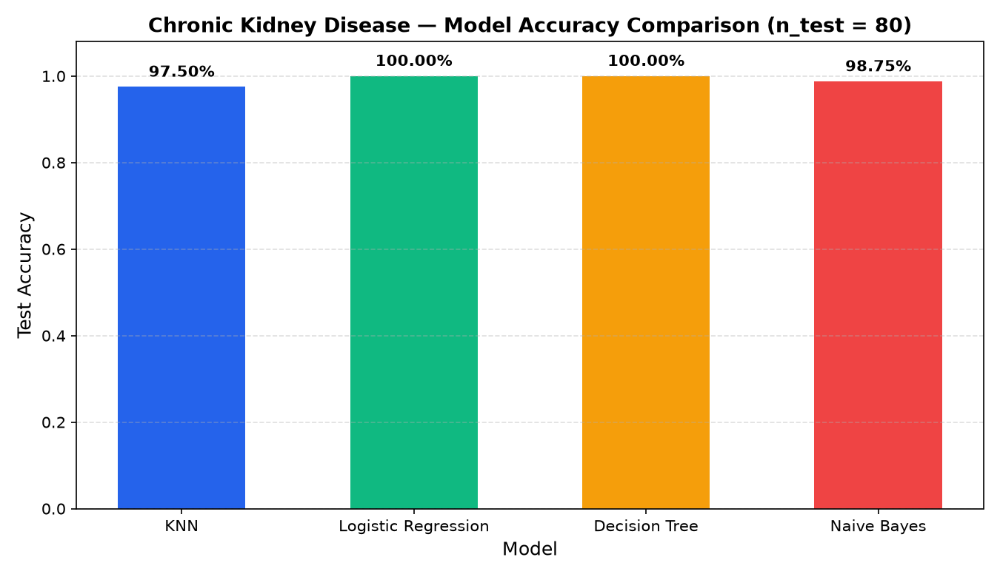

<p align="right"><a href="README.md">TR</a> | <b>EN</b></p>

# 🩺 Chronic Kidney Disease Classification (ML Comparison)

<p>
  
  
  
  <a href="https://colab.research.google.com/github/umutkilictas/chronic-kidney-disease-ml/blob/main/VeriAnalizi.ipynb"></a>
</p>

End-to-end data cleaning, feature scaling, and comparative evaluation of four supervised machine learning classifiers (**KNN**, **Logistic Regression**, **Decision Tree**, **Gaussian Naive Bayes**) on the UCI **Chronic Kidney Disease (CKD)** clinical dataset (`400` patients, `24` clinical features).

---

## 🚀 Data Cleaning & Preprocessing Pipeline

Raw clinical records in `kidney_disease.csv` contain several data quality pitfalls that must be resolved before modeling:

1. **Preventing Target Leakage (`id` removal):** In the raw dataset, all `ckd` records occupy `id = 0..249` while `notckd` records occupy `id = 250..399`. Dropping `id` prevents tree/linear models from memorizing row indices instead of learning clinical biomarkers.
2. **Whitespace & Tab (`\t`) Sanitization:** Raw categorical strings include trailing tabs and leading spaces (`'ckd\t'`, `'\tno'`, `'\tyes'`, `' yes'`, `'?'`). Applying `.str.strip()` before `LabelEncoder` prevents spurious extra classes.
3. **Missing Value Imputation:**
   - **14 Numeric Features (`age`, `bp`, `sg`, `al`, `su`, `bgr`, `bu`, `sc`, `sod`, `pot`, `hemo`, `pcv`, `wc`, `rc`):** Coerced to floating-point and imputed with the column **median**.
   - **10 Categorical Features (`rbc`, `pc`, `pcc`, `ba`, `htn`, `dm`, `cad`, `appet`, `pe`, `ane`):** Imputed with the column **mode** and encoded via `LabelEncoder`.
4. **Feature Standardization (`StandardScaler`):** Standardizes numeric features of vastly different magnitudes (e.g., white blood cell count `wc` in `4,500–12,200` vs. specific gravity `sg` in `1.005–1.025`), ensuring fast convergence for `LogisticRegression` and balanced Euclidean distances for `KNeighborsClassifier`.

---

## 📊 Model Comparison Results

Evaluated on an `80% / 20%` train-test split (`320` train, `80` test patients, `random_state=42`):

| Model | Test Accuracy (`n = 80`) | Correct Predictions |
|---|---|---|
| **Logistic Regression** | **100.00%** | `80 / 80` |
| **Decision Tree (CART)** | **100.00%** | `80 / 80` |
| **Gaussian Naive Bayes** | **98.75%** | `79 / 80` |
| **K-Nearest Neighbors (`k = 5`)** | **97.50%** | `78 / 80` |

<p align="center">
  
</p>

---

## 📁 Project Structure

```text
chronic-kidney-disease-ml/
├── images/
│   └── model_comparison.png        # Test accuracy comparison chart across the 4 classifiers
├── VeriAnalizi.ipynb               # Data cleaning, preprocessing & model evaluation notebook
├── kidney_disease.csv              # UCI Chronic Kidney Disease dataset (400 records)
├── LICENSE
├── README.md                       # Turkish documentation (default)
└── README.en.md                    # English documentation
```

---

## ⚙️ Installation & Usage

```bash
git clone https://github.com/umutkilictas/chronic-kidney-disease-ml.git
cd chronic-kidney-disease-ml
pip install pandas numpy scikit-learn matplotlib jupyter
jupyter notebook VeriAnalizi.ipynb
```

---

## 📄 License

Licensed under the [MIT License](LICENSE).
