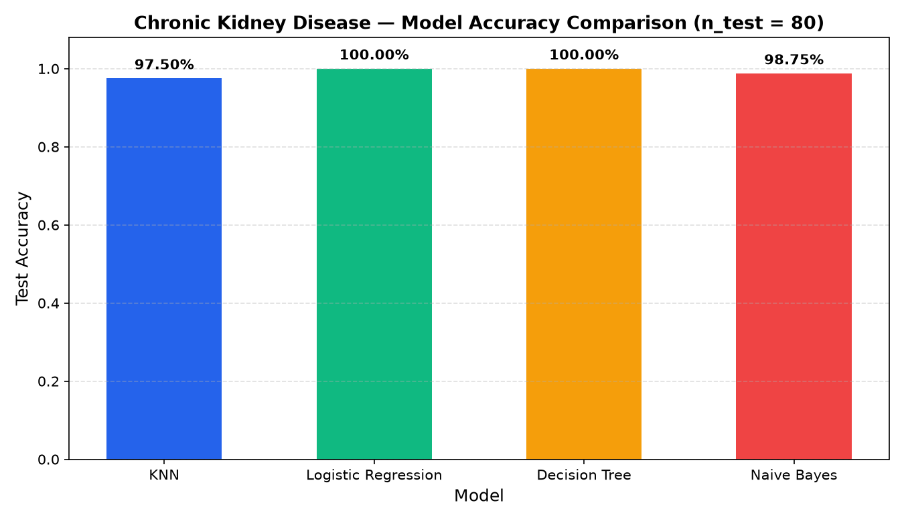

<p align="right"><b>TR</b> | <a href="README.en.md">EN</a></p>

# 🩺 Kronik Böbrek Hastalığı Sınıflandırması (Chronic Kidney Disease ML)

<p>
  
  
  
  <a href="https://colab.research.google.com/github/umutkilictas/chronic-kidney-disease-ml/blob/main/VeriAnalizi.ipynb"></a>
</p>

UCI **Chronic Kidney Disease (CKD)** klinik veri seti (`400` hasta, `24` tıbbi özellik) üzerinde kapsamlı veri temizleme, özellik ölçekleme ve 4 farklı makine öğrenmesi sınıflandırma modelinin (**KNN**, **Logistic Regression**, **Decision Tree**, **Gaussian Naive Bayes**) karşılaştırmalı analizi.

---

## 🚀 Veri Ön İşleme ve Metodoloji

Ham klinik veri setinde (`kidney_disease.csv`) doğrudan model eğitimini bozan veri kalitesi sorunları tespit edilerek aşağıdaki ön işleme boru hattı (pipeline) uygulanmıştır:

1. **Veri Sızıntısının (Target Leakage) Önlenmesi:** Ham veri setinde hasta kayıtları `id = 0..249` (`ckd`) ve `id = 250..399` (`notckd`) olarak sıralı bulunduğu için, modellerin sıra numarasını ezberlemesini önlemek amacıyla `id` sütunu eğitim öncesinde veri setinden çıkarılmıştır.
2. **Bozuk Metin / Sekme (`\t`) Karakterlerinin Temizlenmesi:** Ham CSV içerisindeki `'ckd\t'`, `'\tno'`, `'\tyes'`, `' yes'` ve `'?'` gibi bozuk dizgiler `.str.strip()` ile temizlenerek `classification` ve kategorik değişkenlerdeki sahte sınıf oluşumu engellenmiştir.
3. **Eksik Veri Ataması (Imputation):**
   - **14 Sayısal Özellik (`age`, `bp`, `sg`, `al`, `su`, `bgr`, `bu`, `sc`, `sod`, `pot`, `hemo`, `pcv`, `wc`, `rc`):** Sayısal tipe dönüştürülüp uç değerlere dayanıklı olması için **medyan (`median`)** ile doldurulmuştur.
   - **10 Kategorik Özellik (`rbc`, `pc`, `pcc`, `ba`, `htn`, `dm`, `cad`, `appet`, `pe`, `ane`):** En sık tekrar eden değer (**mod / `mode`**) ile doldurulup `LabelEncoder` ile sayısallaştırılmıştır.
4. **Özellik Ölçekleme (`StandardScaler`):** Beyaz kan hücresi sayısı (`wc`: `4.500–12.200`) ile idrar özgül ağırlığı (`sg`: `1.005–1.025`) arasındaki ölçek farkını gidermek için eğitim verisi üzerinde `StandardScaler` uygulanmıştır.

---

## 📊 Model Karşılaştırma Sonuçları

Veri seti `%80` eğitim (`320` hasta) ve `%20` test (`80` hasta, `random_state=42`) olarak ayrıldığında elde edilen test sonuçları:

| Model | Test Doğruluğu (`n = 80`) | Doğru Tahmin |
|---|---|---|
| **Logistic Regression** | **%100,00** | `80 / 80` |
| **Decision Tree (CART)** | **%100,00** | `80 / 80` |
| **Gaussian Naive Bayes** | **%98,75** | `79 / 80` |
| **K-Nearest Neighbors (`k = 5`)** | **%97,50** | `78 / 80` |

<p align="center">
  
</p>

---

## 📁 Proje Yapısı

```text
chronic-kidney-disease-ml/
├── images/
│   └── model_comparison.png        # 4 modelin test doğruluk karşılaştırma grafiği
├── VeriAnalizi.ipynb               # Veri temizleme, ön işleme ve model karşılaştırma notebook'u
├── kidney_disease.csv              # UCI Chronic Kidney Disease veri seti (400 kayıt)
├── LICENSE
├── README.md                       # Türkçe dokümantasyon (varsayılan)
└── README.en.md                    # İngilizce dokümantasyon
```

---

## ⚙️ Kurulum ve Çalıştırma

```bash
git clone https://github.com/umutkilictas/chronic-kidney-disease-ml.git
cd chronic-kidney-disease-ml
pip install pandas numpy scikit-learn matplotlib jupyter
jupyter notebook VeriAnalizi.ipynb
```

---

## 📄 Lisans

Bu proje [MIT Lisansı](LICENSE) altında lisanslanmıştır.
